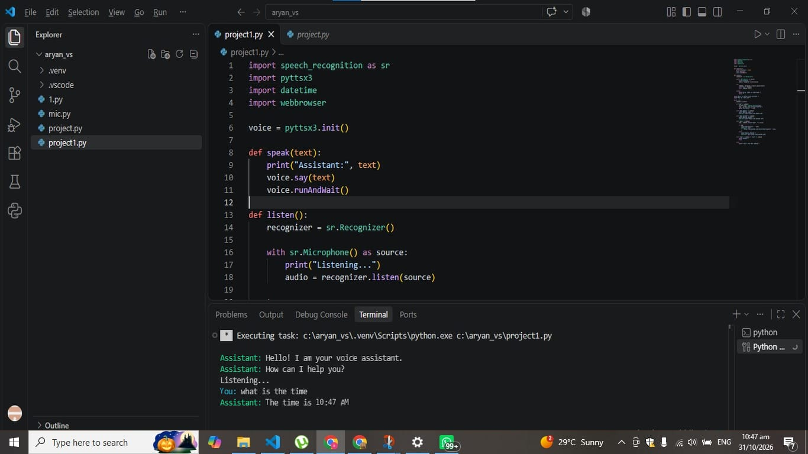
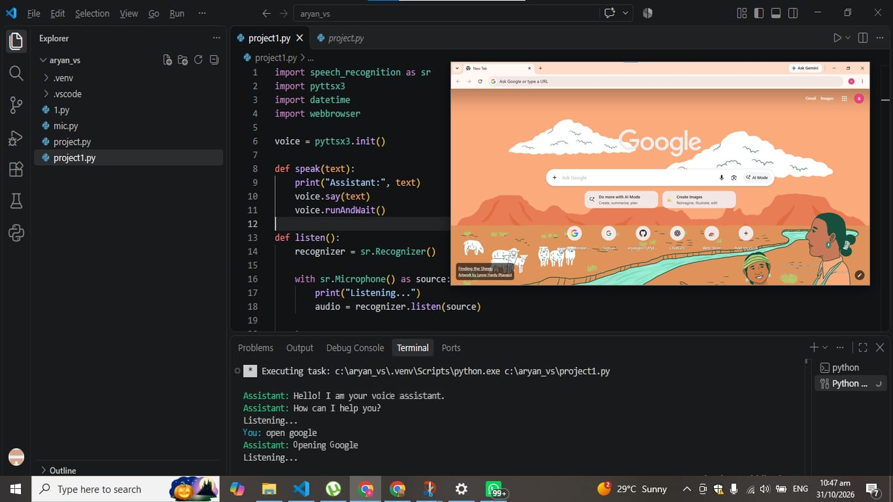

# Python-Voice-Assistant
A Python-based voice assistant that listens to voice commands and performs tasks
This is a beginner-level project

# Requirements

1.python 3.13
2.microphone
3.Required Libraries

# Features

- Opens Google in a web browser
- Opens YouTube
- Tells the current time

# Technologies Used

- Python
- SpeechRecognition
- pyttsx3
- Webbrowser
- Datetime

# Purpose

This project helped me learn Python programming, speech recognition, and automation.

 

# How to Run

1. Install the required Python libraries.
2. Run the Python file.
3. Speak a command and let the assistant perform the task.

   
  ## Output Screenshots
  ### Time

  
  

### Google Search

   
